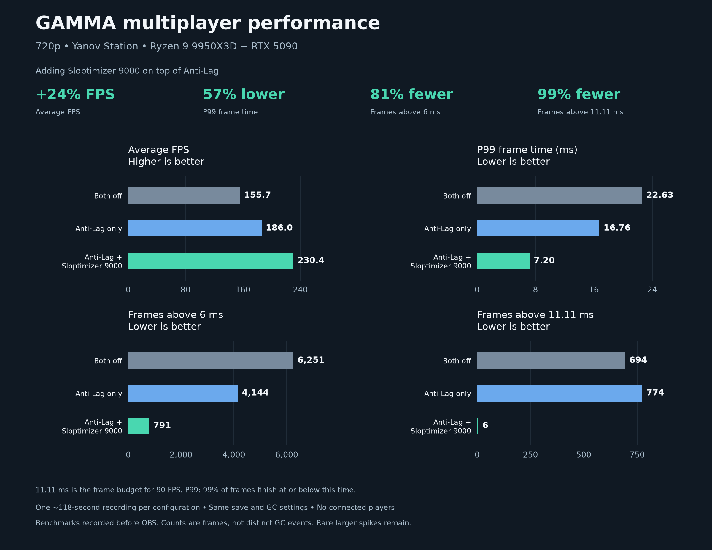
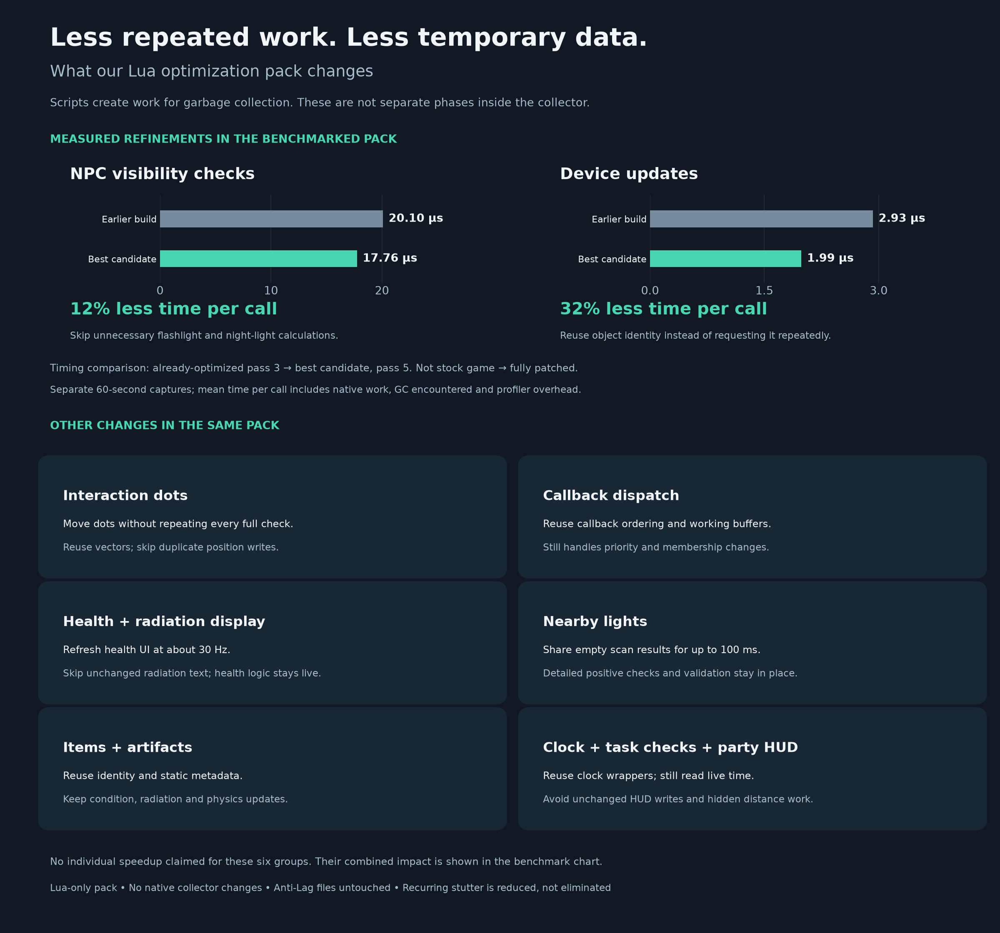

# Sloptimizer 9000 for Stalker GAMMA

**Version 2.9 experimental** · Lua optimization pack

**[Download Sloptimizer 9000 v2.9 — MO2-installable ZIP](https://github.com/businessdrewski-hash/sloptimizer-9000-for-Stalker-GAMMA/releases/download/v2.9-experimental/Sloptimizer-9000-2.9-experimental.zip)**

[Release notes and downloads](https://github.com/businessdrewski-hash/sloptimizer-9000-for-Stalker-GAMMA/releases/tag/v2.9-experimental)

This upload is the best measured candidate used in the three-way comparison below. Later experimental changes are not included. No engine binaries, profilers, personal settings, or save files are included.

**Creator:** Me. Credit to the original authors of the mods this builds on.

**Short Description:** Reduces stuttering in 0.9.5 GAMMA by cutting redundant script work and garbage collection pressure. Lua-only, compatible with vanilla 0.9.5 GAMMA and xrRazom multiplayer. Experimental and entirely vibecoded as I needed to fix my own setup to avoid stutters.

**Problem:** I started working on this because I was getting around 60 FPS with stutters into the 40s at Yanov Station and other areas with lots of items or NPCs, despite running a 9950X3D and 5090. GPU usage sat around 60% and overall CPU usage around 15%. Adjusting the Lua GCstep sliders only traded bigger spikes farther apart for smaller spikes closer together. They never actually went away, so I used AI to collect and analyze logs, direct it through fixes, and became the human guinea pig to test them ingame instead of moving lua gc step sliders around for eternity.

**Reason problem exists:** Scripts were repeatedly checking interaction dots, nearby objects, and UI state while creating temporary data the garbage collector had to clean up. That bottlenecked the CPU side of the game despite ~14% CPU usage. 

**Fix:** My pack cuts repeated work and temporary allocations in interaction dots, callbacks, health and radiation displays, light scans, the multiplayer HUD, and item/artifact updates. The GC sliders given with vanilla GAMMA mostly redistribute the spikes while this pack reduces the repeated work and memory churn behind them.

**After fix:** Now I’m seeing 98–99% GPU usage at 4K, so the GPU is finally becoming the bottleneck. Frametimes are MUCH better (see the graph below) and avg frames went from 80 to 140 in heavy areas at 4K.

## Hard tested benchmark results

Three tests on the multiplayer engine:

| Configuration | Average FPS | P99 frame time | Frames over 6 ms | Frames over 11.11 ms |
| --- | ---: | ---: | ---: | ---: |
| Anti-Lag and Sloptimizer both off | 155.7 | 22.63 ms | 6,251 | 694 |
| Anti-Lag only | 186.0 | 16.76 ms | 4,144 | 774 |
| Anti-Lag + Sloptimizer 9000 | **230.4** | **7.20 ms** | **791** | **6** |

Adding Sloptimizer on top of Anti-Lag:

* **24% higher average FPS**
* **57% lower P99 frame time**
* **81% fewer frames over 6 ms**
* **99% fewer frames over 11.11 ms**

These above tests were at **720p** specifically to take pressure off the GPU and measure any engine bottleneck. All three runs used the same save, settings, and FOV, recording about two minutes each. xrRazom was enabled, but nobody else was connected. These benchmarks were recorded before the separate OBS video runs.

11.11 ms is the frame budget for 90 FPS. Lower P99 frame time is better. These counts are frames over the threshold, not individual GC runs.

This is one comparison on my setup, so don’t expect identical gains everywhere. You should expect almost no gains if your GPU is at 99% already as this is a CPU-side fix.

## Specific changes

* Interaction dots: Stops duplicate updates and separates moving dots on screen from checking visibility, interaction state, and styling. Dots can follow the camera without repeating every expensive check. It also reuses temporary vectors.

* Script callbacks: Caches the initial callback ordering and reuses working buffers instead of rebuilding everything on each update. It still handles callbacks being added, removed, or changing priority.

* Body health display: Limits the display about 30 times per second. Health calculations still run normally. I can’t even notice the difference playing at 120fps.

* Radiation display: Avoids repeatedly converting and writing the same text when the displayed value hasn’t changed.

* Light flicker checks: Shares negative nearby-object scan results between lamps in the same area for up to 100 ms. Positive results still use the original detailed check, and detected mismatches disable the shortcut.

* Multiplayer party panel: Stops unnecessary panel updates outside a multiplayer session. While connected, it avoids rewriting unchanged fields and calculating distance text for a hidden field. The existing twice-per-second refresh stays the same.

* Items and artifacts: Removes redundant ID, section, distance, and clock lookups where they aren’t needed. Tracked items keep their original update path, and artifact condition, radiation, and physics handling remain in place.

* Clock and task checks: Reuses the engine device wrapper while still reading live values, rather than repeatedly requesting another wrapper.

The timing bars above compare two already-optimized builds, not the stock game against the whole pack. They measure script execution, including encountered GC, not separate collector phases.

## Installation

Close the game and install the [Sloptimizer 9000 ZIP](https://github.com/businessdrewski-hash/sloptimizer-9000-for-Stalker-GAMMA/releases/download/v2.9-experimental/Sloptimizer-9000-2.9-experimental.zip) through MO2. Use this installable ZIP, not GitHub’s “Download ZIP” source archive.

For best results, I recommend installing **Anti-Lag for GAMMA** as well. It’s optional, not required, but the combination gave the best results in my testing.

Enable Sloptimizer **below Anti-Lag and the original mods it optimizes in MO2’s left pane**. Keep the original mods enabled. Sloptimizer doesn’t replace Anti-Lag’s scripts.

Disable older versions of Sloptimizer and any testing/profiler harnesses before enabling this version.

Launch normally and give it about ten seconds after loading to observe frametimes.

To remove it, disable the pack and restart. You can check which fixes activated in `appdata/logs/gamma-optimization-status.txt`.

## Compatibility

Tested on my vanilla 0.9.5 GAMMA/xrRazom setup. Other versions and mod lists may differ. Tested on 3 systems now total with notable FPS/frametime improvements reported on all primarily for those with non-GPU bottlenecked systems. This pack only contains Lua scripts. It doesn’t replace any engine files or change your GC settings.
## Experimental of experimental work (not included in this version)
I also tested a change to the GC in the public engine source. Profiling showed it was scanning roughly 100k userdata objects during one phase. Much of the frame pause came from finding what needed cleanup, rather than actually cleaning it up.

The change I made spreads most of that search into smaller batches, then rechecks the remaining candidates before finalization. GC time dropped from roughly 4–6 ms to 1.6 ms, with about 52% fewer frames above 6.2 ms in separate SP tests. Some spikes remained.

It isn’t included here because it requires a rebuilt engine, not a Lua mod. I don’t have a matching source for the multiplayer engine (it’s not open source yet), and swapping in the SP build would break multiplayer compatibility for our run at the moment. It also needs longer gameplay testing before I’d release it separately for Vanilla GAMMA.
